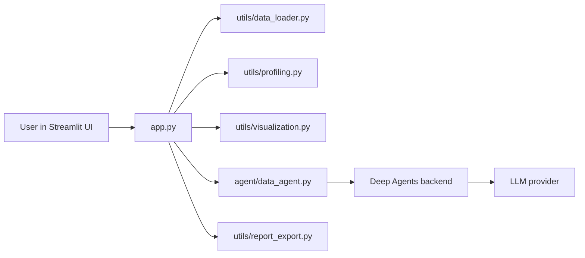

# AI Data Analysis Agent

An end-to-end LangChain Deep Agents portfolio app for analyzing uploaded CSV files with a Streamlit interface, profiling, visualizations, and downloadable reports.

## Overview

This project turns the official Deep Agents data analysis tutorial into a production-oriented portfolio app. It accepts a user-uploaded CSV, validates and profiles it, and lets a model-backed Deep Agent answer natural-language questions about the dataset.

The app is intentionally structured as a lightweight, single-developer portfolio project with a clear separation between UI, data ingestion, profiling, visualization, agent orchestration, and report export.

## Problem statement

Many business users need to ask questions about CSV data without writing Python code. This project provides a safer, more transparent workflow: upload a file, inspect schema/data quality, ask a question in natural language, and get a fact-grounded analysis with charts and an exportable report.

## Key features

- CSV upload with validation and file-size constraints
- Dataset preview and summary profiling
- Follow-up natural-language Q&A for the same uploaded file
- Deep Agents integration using LangChain backend support
- Plotly-generated charts for numeric and time-based relationships
- Markdown report export for user download
- Session-scoped reset and dataset replacement safeguards
- Automated tests for deterministic logic

## Architecture



## Technology stack

- Python 3.12
- Streamlit for the user interface
- Pandas for CSV parsing and profiling
- Plotly for interactive charts
- Deep Agents for backend-powered analysis
- Pytest for deterministic project tests
- GitHub + Streamlit Community Cloud for deployment

## Local setup

```bash
cd data-analysis-agent
python -m venv .venv
.venv\Scripts\activate
pip install -r requirements.txt
copy .env.example .env
```

Then set your secrets in `.env` or Streamlit secrets.

## Environment variables and secrets

The app supports two paths:

1. Local development with a model API key and an execution backend
2. Hosted deployment with Streamlit secrets and a sandbox-backed Deep Agents backend

Example values in `.env.example`:

```dotenv
GOOGLE_API_KEY="your-google-api-key"
DEEP_AGENT_MODEL="google_genai:gemini-2.5-flash"
LANGSMITH_API_KEY="your-langsmith-api-key"
DEEPAGENT_BACKEND="local-shell"
```

> Never commit real credentials or uploaded private data.

## Running the app

```bash
streamlit run app.py
```

## Example questions

- Which products generated the highest revenue?
- How does revenue change over time?
- Which columns contain the largest amount of missing data?
- Are there outliers in the sales or performance metrics?

## Testing

Run the automated tests:

```bash
pytest -q
```

## Deployment

### GitHub

1. Initialize a Git repository if needed.
2. Commit the project files.
3. Push to a public GitHub repository.
4. Connect the repository to Streamlit Community Cloud.

### Streamlit Community Cloud

1. Open Streamlit Community Cloud.
2. Select "New app".
3. Choose the GitHub repository and branch.
4. Set the main file to `app.py`.
5. Add required secrets through the platform UI.
6. Deploy the app.

### Required runtime notes

This app depends on a supported Deep Agents backend and a model provider. On Streamlit Community Cloud, the safest pattern is to use an external sandbox or a properly configured hosted execution service. The local shell backend is intended for controlled local environments and should not be treated as a public-safe backend.

## Security considerations

- Uploaded files are treated as untrusted input.
- Do not upload private or sensitive data unless authorized.
- Keep API keys in environment variables or Streamlit secrets.
- Use a restricted sandbox or a platform-provided execution backend.
- Avoid logging raw uploaded files or secret values.

## Known limitations

- Live model-backed analysis requires an LLM provider and a compatible backend.
- Public deployment depends on external sandbox support or confirmed host access.
- If no backend is configured, the app keeps the dataset upload and profiling flow but prevents unconfigured analysis.

## Future improvements

- Add configurable agent memory and persistence
- Support more chart types and richer analysis summaries
- Add CSV schema inference and anomaly detection
- Provide chart exports in PNG/SVG where supported
- Add a hosted sandbox provider integration for fully managed remote execution
